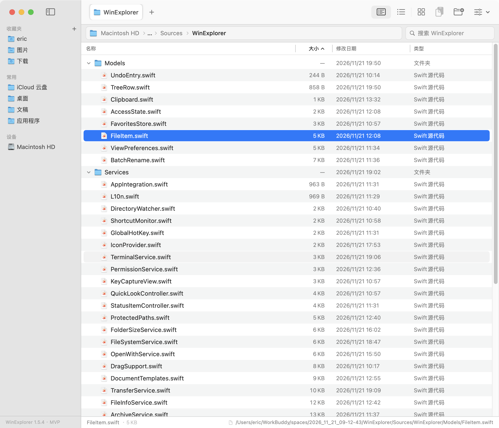
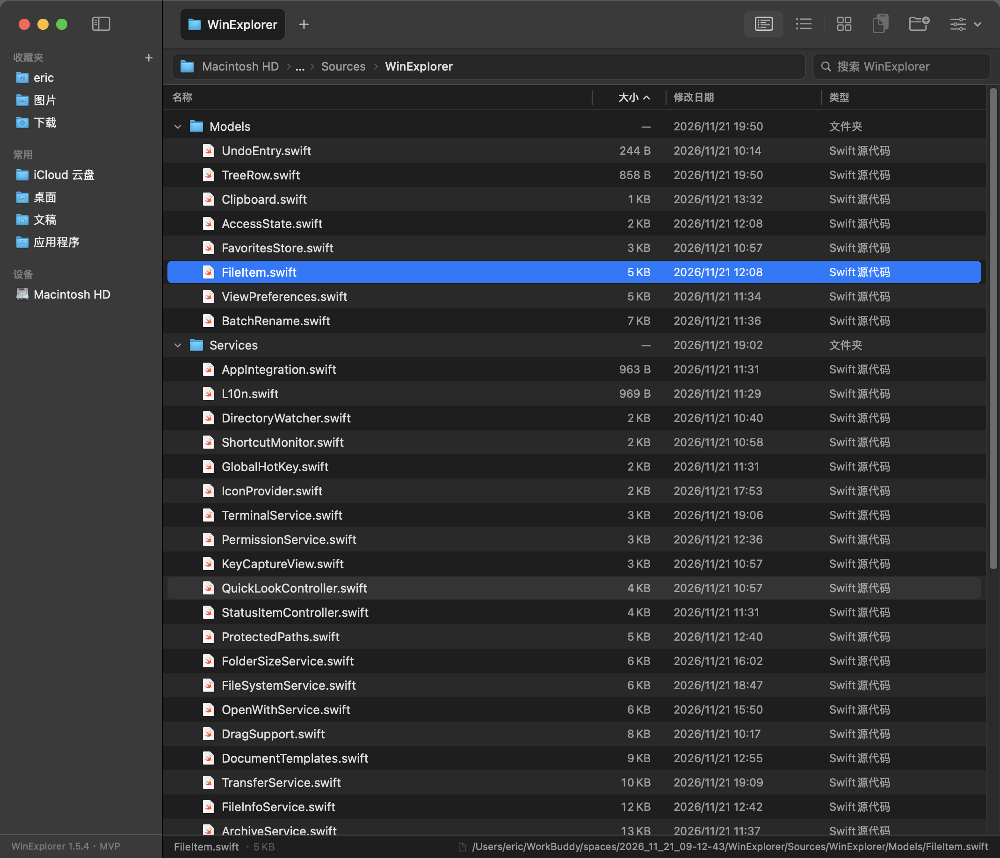
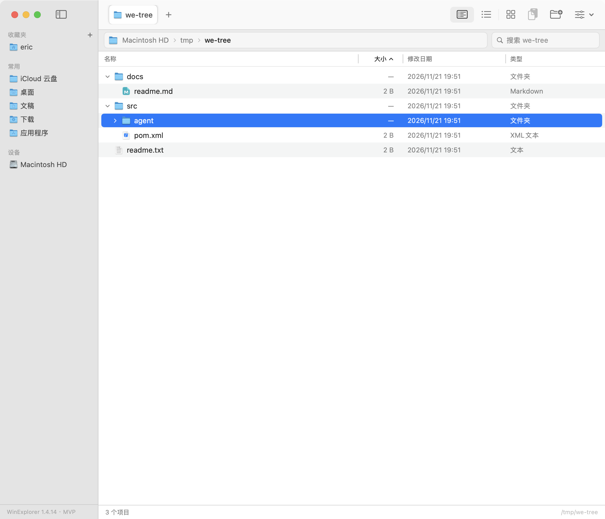

# WinExplorer

**A Windows Explorer–style file manager for macOS — built with plain SwiftUI, zero third-party dependencies.**




中文说明见 [README.zh-CN.md](README.zh-CN.md)。

---

## Why

macOS's Finder and Windows's File Explorer encode two different sets of habits. If you've spent
years in Explorer, Finder keeps getting in the way: folders don't sort first, there's no
expandable tree in the list, the path bar isn't editable, <kbd>F2</kbd> doesn't rename, and
<kbd>Backspace</kbd> doesn't go up a level.

WinExplorer is a native macOS app that behaves like Explorer where it matters, while looking
like it belongs on the Mac. Not a port, not an Electron wrapper — ~13.7k lines of Swift,
SwiftUI + AppKit, built as a plain SwiftPM executable (there is no `.xcodeproj`).

## Features

**Navigation**

- Expandable **tree view** in the list — click the disclosure triangle to see a folder's
  contents in place, with per-level indentation and the full path of the selected item in the
  status bar
- **Tabs** with drag-out-to-new-window and drop-on-`+`-to-open-in-new-tab
- **Editable address bar** (<kbd>⌘L</kbd>): <kbd>Enter</kbd> to go, <kbd>Tab</kbd> to complete;
  a bad path turns red instead of navigating
- Breadcrumbs collapse to `first › … › last two` on deep paths, with a menu listing every
  hidden segment
- Back / forward / up with a real history stack, buttons and menu items disabling in sync

**File operations**

- Copy / cut / paste, with the system pasteboard bridged both ways (paste to and from Finder)
- Drag and drop onto folder rows, empty space, the sidebar and breadcrumb segments —
  move within a volume, copy across volumes, <kbd>⌥</kbd> forces copy, <kbd>⌘</kbd> forces move
- Rename in place (<kbd>F2</kbd>), batch rename for multi-selection
- **Move to Trash with a cascade summary** — before anything is deleted you see
  "includes 3 subfolders, 12 files"; permanent delete is a separate, harder action
- **Open With** — pick an app for this one time, or set the system default, without shelling
  out to AppleScript
- Undo / redo covering rename, move, copy, new folder and trash

**Look and feel**

- Detail list with resizable columns, alternating row stripes, hairline column separators in
  the header, and Finder-proportioned selection highlights
- Three view modes (details / compact list / icon grid)
- Light and dark appearance, both first-class

**Engineering**

- **Nothing blocks the main thread**: directory reads, icon extraction and folder-size scans
  all run off-main with generation tokens, so a stalling network share can't freeze the window
- **Built-in run log** at `~/Library/Logs/WinExplorer/` with main-thread hang detection and
  `fd` / thread / memory sampling — because "it broke after a while" is not a bug report you
  can act on
- **404 self-test assertions**, runnable in one command, exercising real files in a temporary
  directory (no mocks)
- **22 ADRs** in [`docs/adr/`](docs/adr) recording every non-obvious decision — including the
  ones that were later reverted

## Screenshots

| Light | Dark |
|---|---|
|  |  |

Tree view with per-level indentation, two folders expanded, one file selected — the status bar
shows the full path of the selection:



## Requirements

- macOS 14 (Sonoma) or later
- Swift 5.9 toolchain (Xcode 15+ command line tools are enough — no Xcode project needed)

## Build and run

```bash
git clone https://github.com/tianmaoyu/WinExplorer.git
cd WinExplorer

# Build a .app bundle into build/
./scripts/build_app.sh
open build/WinExplorer.app
```

Or just `swift run` for a quick launch without bundling.

Packaging (DMG / PKG):

```bash
./scripts/package_dmg.sh
./scripts/package_pkg.sh
```

Both read the version from `Support/Info.plist`. The bundles are **unsigned and not
notarized** — for distribution you'll want to sign them with your own Developer ID.

## Self-tests

Every build ships with an in-process test suite:

```bash
WINEXPLORER_SELFTEST=1 build/WinExplorer.app/Contents/MacOS/WinExplorer
# → 404 assertions, ends with "SELFTEST OK"
```

Add `WINEXPLORER_LANG=en` for the English pass. The tests build a real directory tree in the
system temp folder and exercise tree expansion, selection ranges, drag-move, trash cascade,
archive handling and undo — no fixture files, no mocking.

## Troubleshooting

The app always writes a run log:

```
~/Library/Logs/WinExplorer/WinExplorer-YYYY-MM-DD.log
```

**Help → Open Run Log** jumps straight to it. The log records every directory read, tree
expansion, context-menu build and file operation, plus a 30-second sample of
`fd / threads / RSS / menuBuilds / window size / items / rows`. When the main thread stalls for
more than 500 ms it dumps the last 40 events leading up to the stall.

If something looks wrong, **Help → Drop a Marker in the Log** pins the current state to the
file so you can point at the exact moment later.

## Architecture

```
Sources/WinExplorer/
├── Models/           FileItem, TreeRow, ColumnWidths, undo entries
├── Services/         filesystem, icons, archive, transfer, run log, permissions
├── ViewModels/       BrowserModel (per tab), TabsModel, FolderSizeCoordinator
└── Views/            list, sidebar, toolbar, panels, dialogs
```

Two decisions shape most of the code:

1. **There is no in-memory tree.** The disk is the tree. The app keeps only "which folders are
   expanded" plus a lazily filled cache of their children, then flattens that into rows for the
   list. Expanding a folder re-reads it, so what you see is what's on disk.
2. **Operations act on the visible rows, not on the current directory.** Everything that touches
   a selection goes through one array that mirrors what's on screen, so a file selected three
   levels deep behaves exactly like one in the current folder.

Both are documented in the ADRs, along with the bugs that motivated them.

## Known limitations

- **DMG / PKG are unsigned and unnotarized.** Gatekeeper will complain on other machines:
  right-click → Open, or `xattr -dr com.apple.quarantine /Applications/WinExplorer.app`.
- **No Quick Look editing, no Finder tags, no iCloud Drive special-casing** — `.app` bundles are
  treated as ordinary files, which is the deliberate scope for now.
- **Tree mode only applies to the detail list.** The compact and icon views stay flat.
- **Searching filters the current folder only** (no recursive search), and drops to a flat list
  while a query is active.
- **The tree's row height is a constant** tied to the current toolbar style; a very different
  toolbar would need that number revisited.

## License

MIT — see [LICENSE](LICENSE).

Third-party code: none. The app icon is drawn at build time by `scripts/make_icon.swift`.
