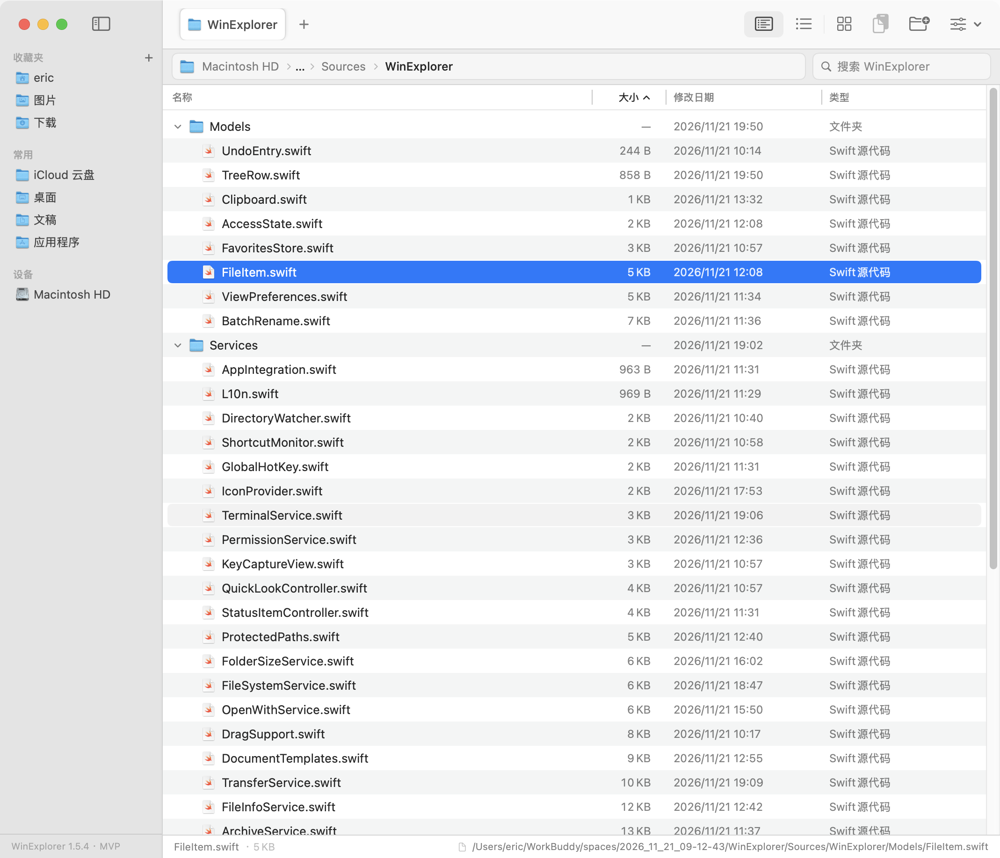
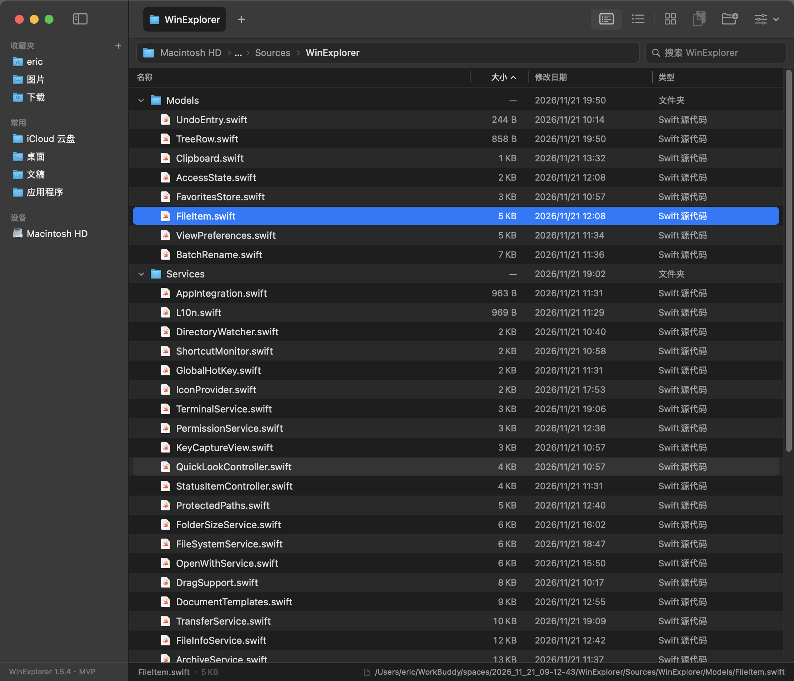
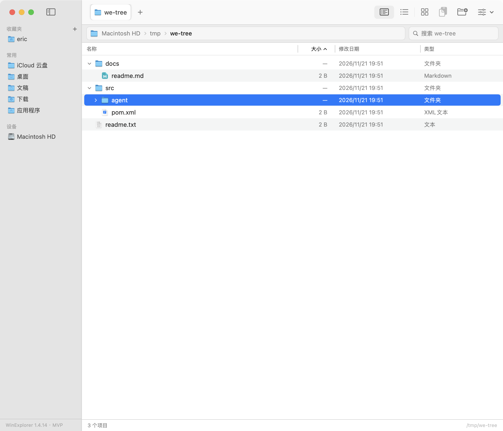

# WinExplorer

**macOS 上的「Windows 资源管理器」式文件浏览器 — 纯 SwiftUI，零第三方依赖。**




English version: [README.md](README.md)。

---

## 为什么做这个

访达和资源管理器是两套操作习惯。如果你在 Windows 上用了很多年，访达总有些地方别扭：
文件夹不排在最前、列表里没有可展开的树、路径栏不能直接输入、<kbd>F2</kbd> 不能重命名、
<kbd>Backspace</kbd> 不返回上一级。

WinExplorer 是一个原生 macOS 应用：在该像资源管理器的地方像资源管理器，在观感上仍然
属于 Mac。不是移植，也不是 Electron 套壳 —— 约 1.37 万行 Swift，SwiftUI + AppKit，
纯 SwiftPM 构建（**没有 `.xcodeproj`**）。

## 功能

**浏览**

- 列表里可展开的**树形结构**：点展开三角就地看子目录，逐层缩进，状态栏显示选中项的完整路径
- **标签页**：可拖出成新窗口，拖文件到 `+` 直接在新标签打开
- **可编辑地址栏**（<kbd>⌘L</kbd>）：<kbd>Enter</kbd> 前往、<kbd>Tab</kbd> 补全；
  路径不存在时红框提示，不会跳走
- 面包屑：路径超过 5 段自动折叠成「首段 › … › 末两段」，点 `…` 列出全部被折叠的段
- 后退 / 前进 / 上一级，完整历史栈，按钮与菜单项的禁用状态同步

**文件操作**

- 复制 / 剪切 / 粘贴，与系统剪贴板双向互通（能粘到访达，也能从访达粘进来）
- 拖放：拖到文件夹行、列表空白、侧边栏、面包屑任意一段；同卷移动、跨卷复制，
  <kbd>⌥</kbd> 强制复制、<kbd>⌘</kbd> 强制移动
- 行内重命名（<kbd>F2</kbd>），多选时批量重命名
- **移到废纸篓前给出级联摘要**：删之前就写明「其中包含 3 个子文件夹、12 个文件」；
  「彻底删除」是另一个更重的动作，单独确认
- **打开方式**：这次用某个应用打开，或设为系统默认，不用 AppleScript 转一道
- 撤销 / 重做：重命名、移动、复制、新建、移入废纸篓都可回滚

**外观**

- 详细信息列表：列宽可拖、交替条纹、表头列分隔线、访达比例的选中高亮
- 三种视图：详细信息 / 紧凑列表 / 图标网格
- 浅色与深色外观都是一等公民

**工程**

- **主线程不干重活**：目录读取、图标提取、文件夹大小统计全部在后台，带代次校验；
  网络卷卡住也不会冻住窗口
- **内置运行日志**：`~/Library/Logs/WinExplorer/`，含主线程卡顿检测与
  `fd` / 线程 / 内存采样 —— 「用一会儿就坏了」这种描述没法排查，日志可以
- **404 条自检断言**，一条命令跑完，全部操作真实临时目录里的文件（不用 mock）
- **22 篇 ADR**（[`docs/adr/`](docs/adr)）记录每个不显然的决定，包括后来被推翻的那些

## 截图

| 浅色 | 深色 |
|---|---|
|  |  |

树形展开、逐层缩进、选中一项后状态栏显示完整路径：



## 下载安装

不想自己编译的话，直接下最新版：[Releases](https://github.com/tianmaoyu/WinExplorer/releases/latest)

| 文件 | 说明 |
|---|---|
| `WinExplorer-1.5.4.dmg` | 打开后把 WinExplorer 拖进「应用程序」 |
| `WinExplorer-1.5.4.pkg` | 双击安装 |

包是 ad-hoc 签名、**未经公证**，首次打开会被 Gatekeeper 拦下。右键点 WinExplorer →
「打开」→ 再点「打开」，或者执行一次：

```bash
xattr -dr com.apple.quarantine /Applications/WinExplorer.app
```

想从源码构建见下一节。

## 环境要求

- macOS 14 (Sonoma) 或更高
- Swift 5.9 工具链（装了 Xcode 15+ 的命令行工具即可，不需要 Xcode 工程）

## 构建与运行

```bash
git clone https://github.com/tianmaoyu/WinExplorer.git
cd WinExplorer

# 构建 .app 到 build/
./scripts/build_app.sh
open build/WinExplorer.app
```

只想快速跑一下，`swift run` 也行。

打包 DMG / PKG：

```bash
./scripts/package_dmg.sh
./scripts/package_pkg.sh
```

版本号统一从 `Support/Info.plist` 读取。这两个包**未签名也未公证**，对外分发前
需要用你自己的 Developer ID 签一次。

## 自检

每次构建都带一套进程内测试：

```bash
WINEXPLORER_SELFTEST=1 build/WinExplorer.app/Contents/MacOS/WinExplorer
# → 404 条断言，最后输出 SELFTEST OK
```

加 `WINEXPLORER_LANG=en` 跑英文一遍。测试会在系统临时目录里建一棵真实目录树，
覆盖树形展开、范围选择、拖拽移动、废纸篓级联、压缩解压、撤销 —— 没有固定夹具，也不 mock。

## 排障

应用始终写运行日志：

```
~/Library/Logs/WinExplorer/WinExplorer-YYYY-MM-DD.log
```

菜单栏 **帮助 → 打开运行日志** 直达。日志记录每次目录读取、树形展开、右键菜单构建、
文件操作，以及每 30 秒一次的
`fd / 线程数 / 内存 / menuBuilds / 窗口尺寸 / items / rows` 采样。
主线程卡顿超过 500ms 时，会把卡住之前的最近 40 条事件一起 dump 出来。

遇到怪现象时，**帮助 → 记录一条现场标记** 会把当前状态钉进日志，事后能精确对到那一刻。

## 架构

```
Sources/WinExplorer/
├── Models/           FileItem、TreeRow、ColumnWidths、撤销记录
├── Services/         文件系统、图标、压缩、传输、运行日志、权限
├── ViewModels/       BrowserModel（每标签一个）、TabsModel、FolderSizeCoordinator
└── Views/            列表、侧边栏、工具栏、面板、对话框
```

两个决定塑造了大部分代码：

1. **不存在一棵内存里的树。** 磁盘本身就是树。应用只保存「哪些文件夹展开着」+
   按需填充的子项缓存，渲染时把它们拍平成行交给列表。展开文件夹会重读磁盘，
   所以看到的就是磁盘上的内容。
2. **操作对象是可见行，不是当前目录。** 所有涉及选区的逻辑都走同一个数组，
   它和屏幕上的行一一对应。所以选中三层深处的文件，行为和选中当前目录里的完全一样。

这两条都在 ADR 里有记录，包括促成它们的那些 bug。

## 已知限制

- **DMG / PKG 未签名未公证。** 在别的机器上 Gatekeeper 会拦：右键 → 打开，
  或 `xattr -dr com.apple.quarantine /Applications/WinExplorer.app`。
- **不做 Quick Look 编辑、不做访达标签、不特殊处理 iCloud 云盘** ——
  `.app` 包一律按普通文件处理，这是当前刻意划定的范围。
- **树形只在详细信息视图生效**，紧凑列表和图标视图保持扁平。
- **搜索只过滤当前文件夹**（不递归），且搜索期间列表退化为扁平。
- **树形的行高是一个常量**，绑定了当前工具栏样式；换成完全不同的工具栏需要重新对一次。

## 许可

MIT，见 [LICENSE](LICENSE)。

无第三方代码。应用图标由 `scripts/make_icon.swift` 在构建时绘制。
